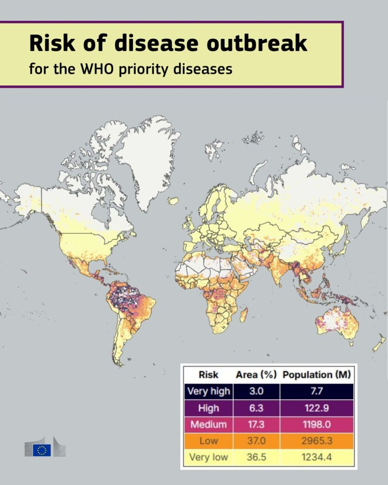
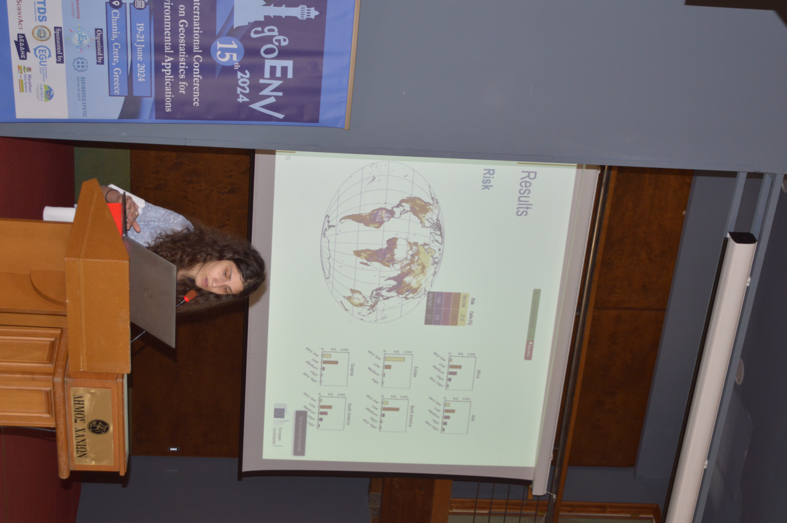
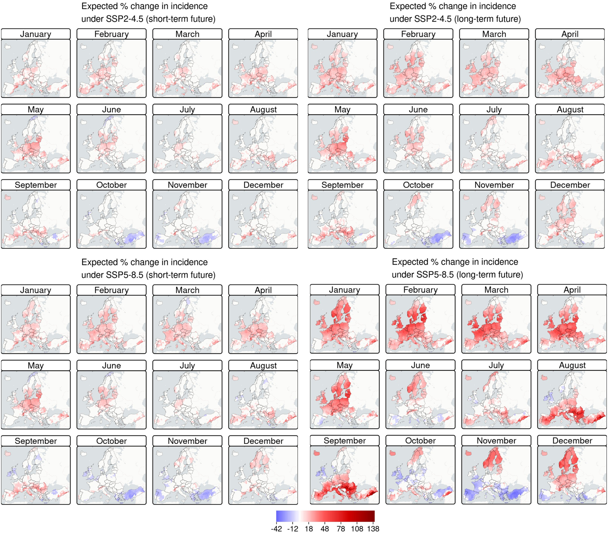
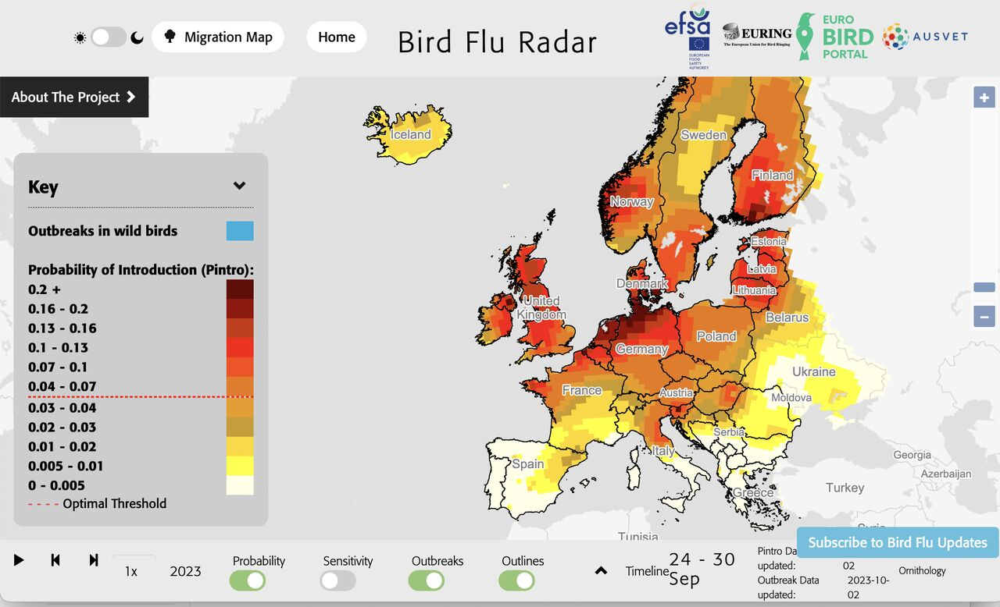
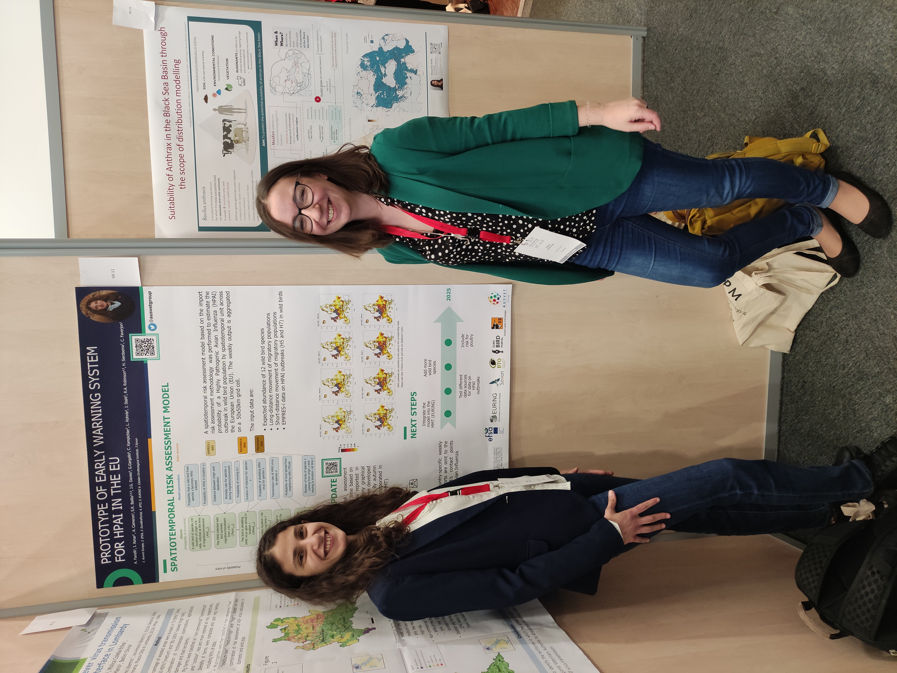
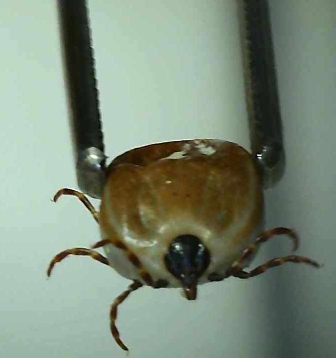

## APES (2023–2026)

From 2023 to 2026, I was Principal Investigator of [APES](https://joint-research-centre.ec.europa.eu/scientific-activities/peseta-climate-change-projects/apes_en) (*Assessing infectious disease outbreaks with Pandemic and Epidemic riSk*) at the European Commission’s Joint Research Centre (JRC). The project integrated epidemiological, environmental, ecological, agricultural and socioeconomic data to investigate epidemic and pandemic risk and inform health and climate policy.

 I developed a [global spatial risk model](https://www.science.org/doi/10.1126/sciadv.adw6363) for the WHO-priority zoonotic diseases, including Ebola, Zika and Crimean–Congo haemorrhagic fever, and an epidemic risk index combining outbreak likelihood with national preparedness and response capacities. The research received international media coverage, including in [*Carbon Brief*](https://www.carbonbrief.org/climate-change-is-creating-new-vulnerabilities-for-disease-pandemics/), [*La Repubblica*](https://www.repubblica.it/green-and-blue/2025/07/23/news/rischio_zoonosi_ambiente_epidemie-424747930/), and Deutschlandfunk.

::: {layout-ncol=2}
{fig-align="left" width=80%}

{fig-align="left" width=80%}

:::

[A companion study](https://www.thelancet.com/journals/lanepe/article/PIIS2666-7762(26)00083-9/fulltext) assessed leptospirosis risk across Europe, projecting increasing risks under future climate scenarios.  The leptospirosis research was disseminated by the [JRC](https://joint-research-centre.ec.europa.eu/jrc-news-and-updates/leptospirosis-europe-climate-change-will-raise-risk-2026-05-12_en) and the [Instituto de Salud Carlos III](https://www.isciii.es/en/w/los-cambios-clim%C3%A1ticos-y-medioambientales-aumentan-el-riesgo-en-europa-de-zoonosis-como-la-leptospirosis).

{fig-align="center" width=80%}

I also developed an [open dataset](http://data.europa.eu/89h/069eec30-98c5-48ab-8e85-5020c681a66f) quantifying heat-related deaths that climate mitigation could avert across 854 European cities by 2050, offering municipal authorities actionable evidence to inform local climate strategies, assess the public health benefits of emissions reductions, and guide policy priorities.

## Leveraging epidemic intelligence data
I conceived and developed [LLMEpidemic Tracker](https://github.com/anjelinejeline/LLMEpidemicTracker), an open-source epidemic intelligence prototype developed as part of my Master’s thesis in Big Data, Data Science and Artificial Intelligence (2026). It uses an [Qwen2.5-14B-Instruct-epi](https://huggingface.co/anjelinejeline/Qwen2.5-14B-Instruct-epi), an open-weight large language model (LLM), to detect and prioritise daily West Nile virus signals from unstructured text, converting them into structured outputs. Local deployment supports data sovereignty, reduces reliance on commercial APIs and streamlines epidemic monitoring.

For the World Organisation for Animal Health (WOAH), I developed a [protocol](https://onlinelibrary.wiley.com/doi/10.1111/zph.12916) to assess the sensitivity of wildlife disease notification systems. Using capture–recapture methods, I evaluated tularemia reporting in lagomorphs across selected North American and European countries (2014–2019), integrating data from WAHIS, ProMED, PubMed, and news data from the [Epidemic Intelligence from Open Sources (EIOS)](https://www.who.int/initiatives/eios) to identify potentially undetected disease events.

I also applied Bayesian additive regression trees (BART) to map Crimean–Congo haemorrhagic fever risk(CCHF), investigating how [open-source data](https://www.eurosurveillance.org/content/10.2807/1560-7917.ES.2023.28.16.2200542) can complement conventional surveillance and improve understanding of neglected disease distribution.

{fig-align="left" width=80%}

## Disease surveillance and early warning-system

At [Ausvet Europe (now Epimundi)](https://epimundi.com/institutional/), I contributed to [antimicrobial resistance (AMR) surveillance and EU reporting](https://efsa.onlinelibrary.wiley.com/doi/abs/10.2903/j.efsa.2023.7867) for the European Food Safety Authority (EFSA) and the European Centre for Disease Prevention and Control (ECDC), as well as [EFSA’s Bird Flu Radar](https://app.bto.org/mmt/avian_influenza_map/avian_influenza_map.jsp) for early warning of highly pathogenic avian influenza (HPAI). 

I also contributed to [Transformational Strategies for Farm Output Risk Mitigation (TRANSFORM)](https://ausvet.com.au/projects/transform/), a United States Agency for International Development (USAID) funded project, in which I developed livestock health and AMR decision-support tools in Indonesia and Vietnam.

Finally,  I applied stochastic scenario-tree models to assess freedom from enzootic bovine leukosis (EBL) through  SOUND-control European Cooperation in Science and Technology (COST) Action scientific mission.

::: {layout-ncol=2}
{fig-align="left" width=100%}

{fig-align="left" width=100%}

:::

## Circular Health research  
As a Circular Health Fellow at the University of Florida’s [One Health Center of Excellence](https://onehealth.phhp.ufl.edu/), I collaborated on interdisciplinary research addressing emerging infectious diseases, veterinary public health, and pandemic preparedness. I carried out research on the risk of [African swine fever virus (ASFV)](https://onlinelibrary.wiley.com/doi/10.1111/tbed.14330) introduction into the United States during the COVID-19 pandemic, advances in [thermostable veterinary vaccines](https://www.mdpi.com/2076-393X/10/2/245?utm_source=researchgate.net&utm_medium=article), and the potential for [SARS-CoV-2 transmission](https://doi.org/10.1093/biosci/biad102) across animal species. This work integrated veterinary, ecological, and biomedical perspectives to inform disease surveillance, vaccine development, and strategies to address emerging infectious disease threats through a One Health approach.

{fig-align="left" width=80%}

## Crimean Congo Haemorragic fever (CCHF) 
I earned my PhD in [Animal Health and Zoonoses (2019-2022)](https://www.uniba.it/en/phd-courses/phd-in-animal-health-and-zoonosis) from the University of Bari, focusing on the risks posed by CCHF to animal and public health. My research combined spatial modelling, environmental data, and risk assessment to investigate the distribution and spread of CCHF across Europe. I identified warmer, drier regions, particularly the Mediterranean basin and areas bordering the Black Sea, as high-risk areas. I also conducted fieldwork in southern Italy, providing evidence of CCHFV circulation in cattle and highlighting the importance of a One Health approach to disease surveillance and prevention.

{fig-align="center" width=40%}

