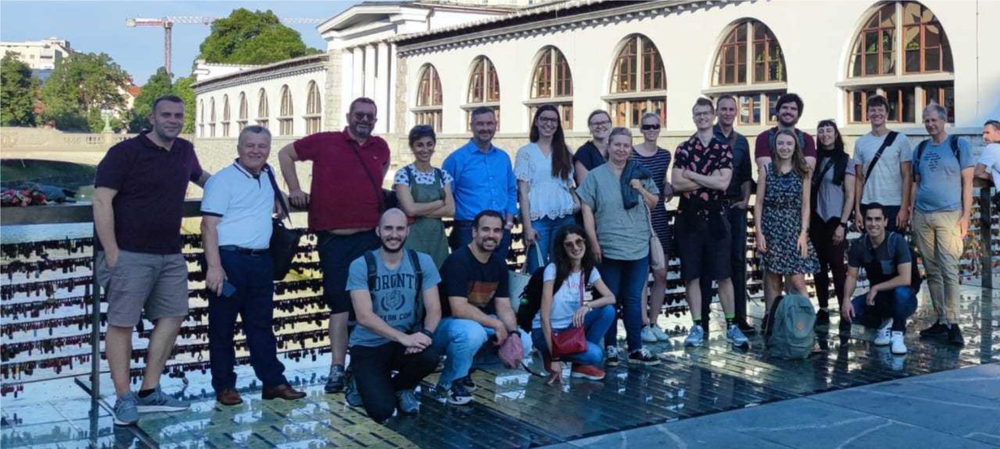
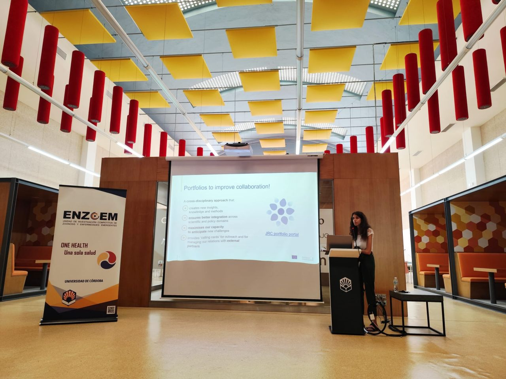
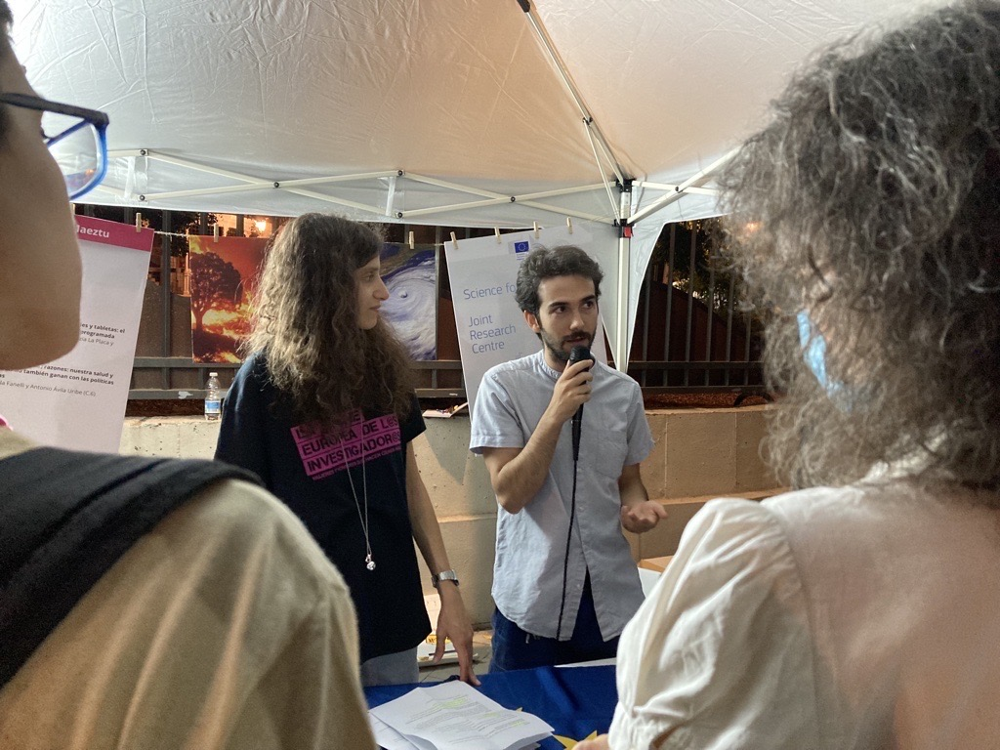
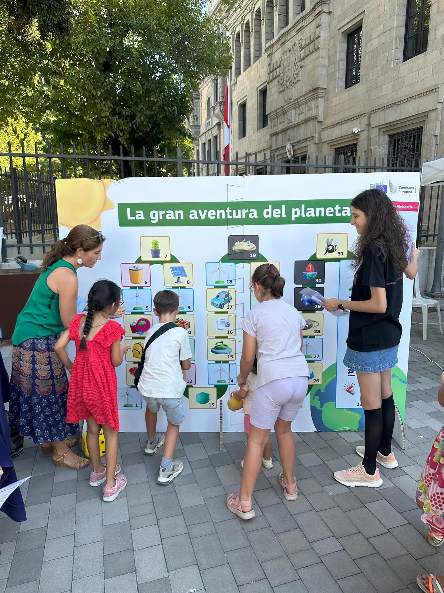

I support the development of early-career researchers, and strengthen their expertise in epidemiology, animal and public health.  Across university teaching, postgraduate supervision, professional training, and specialist residency programmes, I aim to equip students and professionals with the analytical skills, critical thinking, and scientific independence needed to address complex animal and public health challenges.

## University Teaching and Academic Supervision

In 2024–2025, I served as [Associate Professor of Statistics at Universidad Alfonso X el Sabio (UAX)](https://www.uax.com/titulaciones/grado-en-veterinaria), teaching foundational and applied statistics to Veterinary Medicine students. My teaching connected statistical principles with practical applications in veterinary science, helping students develop the quantitative skills needed to interpret data and support evidence-based decisions.

My university supervision experience includes directing an MSc thesis at the Universidad Alfonso X el Sabio (UAX), entitled “Análisis epidemiológico de la dermatitis nodular contagiosa en Europa” (2025–2026). I support students throughout the research process, from formulating research questions and designing studies to managing data, conducting epidemiological analyses, and interpreting findings. Previously, at the University of Bari Aldo Moro, I co-supervised a Veterinary Medicine thesis entitled “Bovine Paratuberculosis: An Underestimated Problem?” (2021–2022).

I have also contributed to the evaluation of doctoral research. In September 2024, I served as an expert in the preliminary evaluation of a PhD thesis at the Universidad de Castilla-La Mancha (UCLM), which investigated the spatiotemporal dynamics of Crimean-Congo haemorrhagic fever virus transmission and its implications for risk assessment in Iberian ecosystems

## Professional Training and Knowledge Exchange

My professional training and knowledge exchange activities bridge epidemiological methods, geospatial analysis, and evidence-informed policy.

I presented my work at international discussion forums, including the **WHO Epidemic Intelligence from Open Sources (EIOS) Community Webinar (2023)**, and at the **EO4Health User Forum (2025)**, which is the European Space Agency (ESA) Initiatives for Open Innovation and Earth Observation in the aftermath of COVID-19.

As an epidemiologist consultant at [Ausvet Europe (now Epimundi)](https://epimundi.com/institutional/) (2022–2023), I delivered hands-on training in **scenario tree modelling in R for quantitative epidemiological risk assessment**. In June 2022, I co-led a specialist course in Ljubljana, Slovenia, with Angus Cameron (11–16 June), focusing on the quantitative evaluation of surveillance sensitivity for animal infectious diseases. In 2023, I also developed training materials and technical documentation on early-detection surveillance methods to support consistent, practical training in scenario tree modelling.

{fig-align="left" width=100%}

Earlier, in 2018, as a Technical Support Officer at [Avia-GIS](https://www.avia-gis.com/), I supported researchers and decision-makers in using **VECMAP**, a GIS-based decision-support tool for vector-borne disease surveillance and risk assessment. This experience strengthened my ability to explain complex analytical methods, interpret spatial outputs, and translate technical results into information that supports evidence-based decisions.

I also collaborate with universities to share my academic and professional experience with students and early-career researchers, fostering engagement with interdisciplinary research and career development. I delivered a seminar about Policy-Oriented and Exploratory Research for [ENZOEM](https://enzoem.es/)  at the University of Córdoba, Spain, in 2025.

{fig-align="left" width=100%}

I collaborate with Oniris VetAgroBio, Faculty of Veterinary Medicine at the University of Nantes, France, to engage with students in the [One Health Emerge Master’s programme](https://www.oniris-nantes.fr/en/study-at-oniris/masters-degree-at-oniris/master-one-health-emerge), as well as veterinary and PhD students.These activities provide opportunities to discuss career pathways in veterinary epidemiology and One Health, highlighting the importance of translating scientific evidence into policy and practice.

### Specialist Mentoring in Veterinary Public Health

As a **Diplomate of the [European College of Veterinary Public Health (ECVPH)](https://ecvph.org/)**, I contribute to the development of future specialists through professional mentoring and specialist training. ECVPH Diplomate status recognises advanced expertise in veterinary public health, acquired through structured postgraduate training, demonstrated professional competencies, and a formal examination.

I currently serve as **ECVPH residency supervisor** for [Liliana Martella (2025–2028)](https://www.unibo.it/sitoweb/liliana.martella2/en) and [Paolo Capozza (2026–2030)](https://www.uniba.it/it/docenti/capozza-paolo), supporting their professional development throughout their specialist training in veterinary public health (Population Medicine). My mentoring approach combines scientific guidance, critical discussion, and support for the development of independent professional judgement, tailored to each resident’s academic and professional background.

Through these activities, I aim to foster a learning environment that connects quantitative methods, epidemiological reasoning, and real-world public health applications, helping students, researchers, and veterinary professionals develop the expertise needed to address emerging infectious diseases and complex One Health challenges.

## Public Engagement & Science Communication

I enjoy bringing research beyond academia and creating opportunities for people of all ages to explore how science connects with everyday life. Through the European Researchers’ Night in Seville, I have helped turn complex topics into engaging, interactive experiences that spark curiosity and encourage scientific discovery.

### 2025 · Climate Policy: Health & Economy
“Cargándonos de (más) razones: nuestra salud y nuestro bolsillo también ganan con las políticas climáticas”

Together with [Antonio Avila](https://www.linkedin.com/in/antonio-avila/), I explored how climate policies can benefit both public health and household finances through an interactive, quiz-based workshop.

### 2026 · The Great Planet Adventure: Rescue Mission
“La Gran Aventura del Planeta: Misión Rescate”
Together with [Isabel González Cuenca](https://www.linkedin.com/in/mar%C3%ADa-isabel-gonzalez-cuenca-853733211/), I co-led a giant board-game adventure for children aged 7–11, using playful challenges and rhymes to inspire curiosity about sustainability and protecting our planet.

::: {layout-ncol=2}
{fig-align="left" width=100%}

{fig-align="left" width=100%}

:::